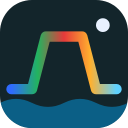

# AquaIllumination Prime

Home Assistant custom integration for the AquaIllumination Prime aquarium lamp (local polling, no cloud).

## Installation

**HACS (recommended):** HACS → ⋮ → Custom repositories → add `https://github.com/Huede82/ha-ai-prime`, type "Integration" → search "AquaIllumination Prime" → Download → restart Home Assistant.

**Manual:** copy `custom_components/ai_prime` into your Home Assistant `config/custom_components/` directory and restart.

Then: Settings → Devices & services → Add integration → "AquaIllumination Prime". Enter the lamp's IP, the
password if the lamp's web UI is protected, and an optional name (default `Prime <last 4 of serial>`).
The lamp's current schedule becomes the first library entry, named "Lampe".

Upgrading from 0.1.x migrates each entry to the schedule library (config entry version 2) on the first start;
the stored schedule becomes "Natur" (or keeps its name). Version-2 entries cannot be downgraded to 0.1.x: a
downgrade needs the integration removed and set up again.

## Entities per lamp

| Entity | Purpose |
|---|---|
| Light | On/off and overall brightness (scales all channels) |
| 5 × Number | Deep red, cool white, green, blue, warm white (0–100 %) |
| Switch "Internal schedule" | Lamp runs its own schedule |
| Switch "Nature mode" | Home Assistant drives the lamp (see below) |
| Switch "Lightning" | Allow lightning flashes during thunderstorms |
| Button "Reload preset from lamp" | Re-read the lamp's schedule as base curve |
| Sensors | Temperature, power (W, computed from the current channel mix and the lamp's per-channel power table; unavailable on firmware without `/api/power`), cloud cover, nature target, moon phase |
| Binary sensors | Fan, thermal shutdown |

Any manual change (light, channel slider) turns the internal schedule and nature mode off.
Turning the internal schedule on turns nature mode off.

## Dashboard card and studio

The integration ships its own Lovelace card (no build step, no CDN). Add it to a dashboard:

```yaml
type: custom:ai-prime-card
entry_id: <config entry id>   # required; the card editor fills it via its lamp picker
```

In the dashboard's card picker choose "AI Prime Studio" and pick the lamp in the dropdown. The compact
card shows the live channel mix, brightness, nature mode, the active schedule (dropdown), temperature/power/fan
and today's curve with a now-line (Home Assistant's time zone). **Einrichten** opens the full-screen studio
with three tabs (German UI by default, English when your Home Assistant language is English):

- **Orte** — weather, sun and moon location (map picker or name search), time mode per sun/moon
  (anchored / real), and "follow another lamp". Shows the resulting times for each location.
- **Farbschema** — color scheme library per lamp: pick a scheme or a template (Natur / Leer) to see it in the
  editor, edit points on a curve (drag, add, delete) or in a table. Changes are always saved as a new scheme
  under a new name ("Als neu speichern", optionally "& aktivieren"); rename, delete and activate in the library.
  Activating writes the scheme to the lamp.
- **Vorschau** — pick today, tomorrow or any date: thin lines are the color scheme, thick lines the lamp
  output, either **Theorie** (sun remap, brightness, night and moon light, no weather) or **Mit Wetter**
  (plus cloud cover and storms), with sunrise/sunset/moonrise/moonset markers, a now-line for today and a list
  of the times, day length, moon phase and weather. A **Licht** card holds the brightness, night light and
  moonlight sliders. **▶ Abspielen** plays the day in 48 s (2 s per hour) with a live readout of the channel
  values and the mixed color; with **Auf Lampe** on, the lamp itself shows the playback (about 10 frames per
  second). Pausing, finishing or leaving the tab hands the lamp back to nature mode (or restores its previous
  schedule/colors); if the studio disappears, Home Assistant restores the lamp after 5 s without frames.

**Lamp write and backup.** Activating a schedule writes it to the lamp's internal schedule (the lamp then also
runs it without Home Assistant). Before Home Assistant writes to a lamp for the first time it reads the lamp's
current schedule and stores it as the read-only schedule **"Original (Lampe)"**; it can be activated or
duplicated at any time, never edited or deleted. If the lamp is unreachable, the write stays pending and is
retried after polls, backing off from 5 up to 30 minutes. If the lamp answers but refuses the schedule, the
change is still stored in Home Assistant, the studio shows "the lamp rejected the schedule" and nothing is
retried. A schedule has at most 32 points; names are limited to 60 characters. A following lamp whose leader is
not loaded keeps its write pending and receives the leader's schedule once the leader is loaded.

**Follow.** A lamp can follow another lamp (no chains, no cycles): it then uses the leader's active schedule and
locations, and its own library and location editing are locked until you stop following.

## Development

Browser harness (mock Home Assistant, Playwright, screenshots in `scripts/card_harness/out/`):

```sh
cd scripts/card_harness && npm install          # once
node run.mjs                                    # PW_CHROMIUM=/path/to/chromium to pick a browser
node --test custom_components/ai_prime/frontend/*.test.mjs   # pure model tests (repo root)
```

Both scripts launch `PW_CHROMIUM` if set, else Playwright's own Chromium (`npx playwright install
chromium-headless-shell`); if that exact revision is missing, any installed headless shell in the Playwright
cache is used.

Live smoke test against a real Home Assistant (read-only: opens the studio and visits the tabs, never saves):

```sh
HA_URL=http://homeassistant.local:8123 HA_TOKEN=<long-lived token> \
  node scripts/studio_smoke.mjs /lovelace/0     # dashboard path with the card
```

## Nature mode

Every minute the integration computes the target from:

1. **Preset** — the lamp's schedule, read at setup; editable in the integration options.
2. **Sun** (location 2) — the preset is stretched so its ramps start at sunrise and end at sunset.
3. **Clouds** (location 1) — live cloud cover from Open-Meteo dims all channels (strength adjustable).
4. **Moon** (location 3) — faint moonlight at night while the moon is up, scaled by moon phase.
5. **Lightning** (location 1) — short flashes during thunderstorms, if the lightning switch is on.

Each location is chosen on a map in the options. Time mode per sun/moon location:
**anchored** (day length of that place, centred on your local noon/midnight) or **real** (actual local times
converted to your time zone). `real` is meant for locations a few hours from home.

Only coordinates (rounded to 2 decimals) are sent to Open-Meteo, every 15 minutes.

### Brightness, night light, moonlight

Three per-lamp settings (options → Simulation, or the studio; followers keep their own values):

- **Brightness** (1–100 %, default 100) scales the whole day curve. It is also applied to the schedule written
  into the lamp, so the lamp's own fallback schedule matches.
- **Night light** (0–5 %, default 0 = off) is a constant glow on the moonlight channel whenever all preset
  channels are 0. Clouds do not dim it. It is *not* written into the lamp schedule, so the lamp's fallback
  schedule stays plain.
- **Moonlight max** (0–5 %, default 3) is the moon's contribution at full moon, added on top of the night light.

### Preset editor (options text form)

The studio's **Farbschema** tab is the main editor now; the text form under Options → Edit preset shows one line per time point: the time, then percent values (0–100, one decimal
allowed) in the vendor app's channel order **blue, green, deep red, warm white, cool white**.
Separators are spaces and/or commas, `#` starts a comment, blank lines are ignored. Times are
`00:00`–`24:00`, each only once, at least two points.

```
# time  blue green deep-red warm-white cool-white (percent)
06:10  0 0 0 0 0
07:10  37 37 37 37 37
07:40  88 88 88 88 88
```

A lamp preset with different times per channel is shown with the union of all times (values interpolated),
so nothing is lost. Saving applies the same times to all channels.

If Home Assistant is down while nature mode is on, the lamp keeps its last value.

See `examples/back_to_internal_schedule.yaml` (hand the lamp back before a shutdown; nature mode stays off afterwards) and `examples/nature_mode_on_start.yaml` (turn nature mode on at every Home Assistant start).

---

### Kurz auf Deutsch

Naturmodus: Home Assistant steuert die Lampe minütlich aus dem Preset, angepasst an Sonnenauf- und
-untergang (Ort 2), Bewölkung (Ort 1), Mondlicht (Ort 3) und optional Blitze bei Gewitter (Ort 1).
Orte, Zeitmodus (verankert / echte Ortszeit), Stärken und das Preset stellt man unter
Einstellungen → Geräte & Dienste → AquaIllumination Prime → Konfigurieren ein.
Jede manuelle Änderung schaltet Naturmodus und internen Zeitplan aus.

## Changelog

### 0.3.1
- Preview: **Auf Lampe** — the playback runs on the real lamp; nature mode (or the previous schedule/colors)
  takes over again on pause, at the end, when leaving the tab, or after 5 s without frames.
- Playback speed 2 s per hour (one day in 48 s).
- Frontend files are served under a versioned path, so the companion app picks up new versions after an
  update.

### 0.3.0
- Per-lamp **brightness** (1–100 %), also applied to the schedule written into the lamp.
- **Night light** (0–5 %, 0.1 % steps, default off) on the moonlight channel; **moonlight max** now in
  0.1 % steps.
- Preview: **Theorie / Mit Wetter** toggle, **▶ Abspielen** with live channel readout and mixed color,
  **Licht** card with the three sliders.

### 0.2.0
- First public release: lamp control, nature mode, power sensor, AI Prime Studio (locations, color schemes,
  preview), lamp schedule write with backup of the original, HACS support.

## License

MIT, see [LICENSE](LICENSE).
